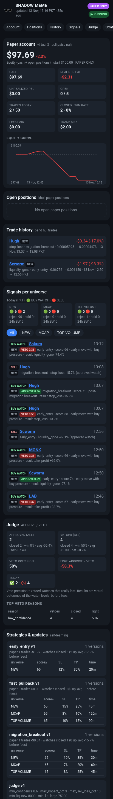

# SHADOW MEME 🕶️

Solana meme coin scanner + **paper-trading** signal bot in Python, built for **Android Termux**
(no VPS, no paid subscriptions) and controlled **only from Telegram**.

> **Paper-only and analysis-only.** There is no live-trading code, no wallet connection and no
> private key, ever. `PAPER_ONLY` is a constant in the code; `.env` cannot turn it off.
> Signals are not financial advice, and the bot reports only results it actually measured.

## Status: v1.2.0 ✅ all 10 phases done + v1.1 accuracy update ([what changed](#v11---accuracy-update-13-nov-2026), [v1.1.1](#v111---13-nov-2026), [v1.1.2 exits](#v112---let-winners-run-13-nov-2026), [v1.1.3 SL 20%](#v113---stop-loss-20-13-nov-2026), [v1.2.0 trades + dashboard](#v120---trades-open-again--new-dashboard-13-nov-2026), [evidence](docs/V11_ANALYSIS.md), [v1.0 test report](docs/TEST_REPORT.md))

| Phase | What | Status |
|---|---|---|
| 1 | Termux installation, config, doctor, verified data sources | ✅ done |
| 2 | Token scanner (PumpPortal stream + fallbacks) | ✅ done |
| 3 | Data collection (price, mcap, liquidity, volume, buys/sells) | ✅ done |
| 4 | Coin safety checker (strict) | ✅ done |
| 5 | Signal engine + strategies + judge agent + MCAP / TOP VOLUME universes | ✅ done |
| 6 | Paper trading engine ($100, $2/trade, quote slippage, fees $0 by default, max 5 open) + self-learning | ✅ done |
| 7 | SQLite database hardening (crash-safe, bounded size, daily backups, CSV export) | ✅ done |
| 8 | Telegram commands, alerts, daily report | ✅ done |
| 9 | Dashboard (Telegram Mini App on GitHub Pages) + self-improving strategies | ✅ done |
| 10 | Complete testing (fresh clone, 35 min end-to-end run, safety audit, Termux review) | ✅ done |

Files for later phases exist as clearly marked stubs (`PHASE = N`, `IMPLEMENTED = False`).

## Quick start on the phone (5 steps)

1. Install **Termux from F-Droid** (not the Play Store). Android: **Settings → Apps → Termux → Battery → Unrestricted**.
2. Paste this in Termux (takes a few minutes; installs only small pure-Python packages, nothing is compiled):

```bash
pkg install -y git python && git clone https://github.com/ahmadrahmani147370-hype/shadow-meme-bot && cd shadow-meme-bot && bash setup_termux.sh
```

3. Put the Telegram token in `.env`: `nano .env` → `TELEGRAM_BOT_TOKEN=...` (chat id `7922990181` is already
   set). Optional: `GITHUB_TOKEN=...` for the full dashboard (see "Dashboard" below). Save: Ctrl+O, Enter, Ctrl+X.
4. **Stop the old FATHER bot** (one token = one program), then start: `bash start.sh`
5. In Telegram: the bot says "SHADOW MEME bot online (paper-only)". Send `/status`, tap **📊 Dashboard**.
   To stop: Ctrl+C in Termux. Update later: `git pull` and `bash start.sh` again.

**Roman Urdu:** (1) F-Droid se Termux, battery "Unrestricted". (2) Upar wali line Termux mein paste karein.
(3) `nano .env` mein `TELEGRAM_BOT_TOKEN=` ke aage token. (4) Purana FATHER bot band karein, phir `bash start.sh`.
(5) Telegram mein `/status` bhejein aur **📊 Dashboard** dabayein. Band karna ho to Termux mein Ctrl+C.

## Running on a PC / Linux box instead of the phone

```bash
git clone https://github.com/ahmadrahmani147370-hype/shadow-meme-bot && cd shadow-meme-bot
pip install -r requirements.txt && cp .env.example .env && nano .env      # TELEGRAM_BOT_TOKEN=...
setsid nohup bash tools/box_run.sh >/dev/null 2>&1 &                       # start (background + watchdog)
bash tools/box_stop.sh                                                     # stop
bash tools/install_autostart.sh                                            # v1.1: restart after a box restart
```

`tools/box_run.sh` writes the bot output to `logs/box_run.log` and its own events to `logs/watchdog.log`,
restarts the bot when it exits (10 s → 300 s backoff; it gives up only on exit 2 = config error) or when the
log is silent for 10 minutes, and logs suspension gaps of the machine. It unsets an exported
`TELEGRAM_BOT_TOKEN` so the value in `.env` is used (an exported variable always wins over `.env`; the bot
also warns about that). With `gh auth login` done on that machine, `DASHBOARD_PUBLISHER=gh` uploads the
full dashboard through the GitHub CLI without putting a token in `.env`.

## Install on Android (Termux) - details

1. Install **Termux from F-Droid** (the Play Store version is outdated). Optional: **Termux:API** and **Termux:Boot**, also from F-Droid.
2. In Termux:

```bash
pkg install -y git python && git clone https://github.com/ahmadrahmani147370-hype/shadow-meme-bot && cd shadow-meme-bot && bash setup_termux.sh
```

3. Check everything:

```bash
python -m shadow.doctor
```

4. Android: **Settings → Apps → Termux → Battery → Unrestricted**, otherwise Android kills it in the background.
5. Try the scanner (phase 2): `python main.py --debug scan 120`, the collector (phase 3): `python main.py --debug collect 300`,
   the safety checker (phase 4): `python main.py --debug safety <mint>` or `python main.py --debug safety-live 300`,
   everything with signals + judge (phase 5): `python main.py --debug signals 600`,
   and paper trading + self-learning (phase 6): `python main.py --debug paper 900` / `python main.py --debug paper report`
6. `nano .env` (Telegram token; chat id is already 7922990181), then `bash start.sh` (`./start.sh` works too when
   Termux's termux-exec is active, which is the default). Everything else is done from Telegram.

**Telegram bot:** SHADOW MEME uses the existing **@Fathersigna147lBot** with owner chat id
`7922990181`. A bot token can only be used by one program at a time, so the old FATHER bot must be
stopped before SHADOW MEME runs (otherwise Telegram answers 409 and the bot logs "another program is
polling this bot token"; alerts still go out, commands wait).

**If the doctor shows `telegram_api` ConnectTimeout** (seen on a Pakistani mobile network while
every other check passed): try another network (Wi-Fi or another SIM) or the free **1.1.1.1 (WARP)**
app. Advanced option: set `TELEGRAM_API_BASE` in `.env` to your own HTTPS Bot API mirror. The
doctor and the bot both use whatever `TELEGRAM_API_BASE` points to.

Update later: `cd shadow-meme-bot && git pull && python -m shadow.doctor`

## Roman Urdu quick start 🇵🇰

1. F-Droid se **Termux** install karein (Play Store wala purana hai). Chahein to **Termux:API** aur **Termux:Boot** bhi.
2. Termux khol kar ye ek line chalayein:

```bash
pkg install -y git python && git clone https://github.com/ahmadrahmani147370-hype/shadow-meme-bot && cd shadow-meme-bot && bash setup_termux.sh
```

3. Sab theek hai ya nahi, check karein: `python -m shadow.doctor` — aakhir mein `READY` aana chahiye.
4. Phone ki Settings → Apps → Termux → Battery → **Unrestricted** kar dein, warna Android background mein band kar deta hai.
5. Scanner test karein (phase 2): `python main.py --debug scan 120` — 2 minute tak naye coins aur migrations screen par aayenge, aakhir mein ginti.
   Collector test (phase 3): `python main.py --debug collect 300` — har coin ki price, market cap, liquidity, volume aur buys/sells, aur 1-minute candles. Aakhir mein batata hai kitne coins track hue, kitne kis wajah se chhore gaye, har API ko kitni calls gayin, aur CPU/RAM kitni lagi.
   Safety test (phase 4): `python main.py --debug safety <mint>` — ek coin ki poori safety report (mint/freeze authority, Token-2022, holders, insiders, dev, liquidity, fake volume, Jupiter par bechne ka test). `python main.py --debug safety-live 300` — 5 minute tak har naye coin ki report, aakhir mein kitne pass/reject hue aur kis wajah se.
   Signals test (phase 5): `python main.py --debug signals 600` — 10 minute tak sab kuch live: naye coins, $1M+ MCAP coins, TOP VOLUME coins, safety, signals aur judge. Har BUY WATCH ke neeche judge ka faisla (APPROVE / VETO) aur wajah. Aakhir mein har list ke signals, judge ki ginti, API calls aur CPU/RAM. `quiet` likhein to REJECT lines screen par nahi aatin (ginti phir bhi hoti hai).
   Paper trading test (phase 6): `python main.py --debug paper 900` — 15 minute tak sab kuch, aur judge jis BUY WATCH ko APPROVE kare us par $2 ka paper trade (asli paisa nahi). Har trade khulne aur band hone par screen par aata hai, slippage (aur agar .env mein fee ho to fee) ke baad nafa/nuqsan ke saath. `python main.py --debug paper report` — balance, khuli positions, history, aaj ki report aur strategies (bina kuch chalaye, database se).
   Database (phase 7): `python main.py --debug db` — database theek hai ya nahi (integrity), paper account aur trades ka hisaab milta hai ya nahi, har table ka size, backups. `... db backup` abhi backup, `... db export` trades aur rozana report CSV (Excel) mein `data/exports/` mein.
6. `nano .env` mein Telegram token likhein (chat id pehle se 7922990181 hai), phir `./start.sh`. Baaqi sab Telegram se.

Scanner do tarah se coins dhoondta hai: PumpPortal websocket (live) aur GeckoTerminal + RugCheck polling. Test mein websocket ne sirf ~19% naye pump.fun coins diye, is liye polling hamesha on rehti hai. Ek coin dobara nahi aata, restart ke baad bhi nahi.

Agar doctor mein `telegram_api` par **ConnectTimeout** aaye (Pakistan ke kuch networks par Telegram block hota hai): doosra network (Wi-Fi ya doosri SIM) try karein, ya muft **1.1.1.1 (WARP)** app on karein. Advanced: `.env` mein `TELEGRAM_API_BASE` apne HTTPS mirror par set karein. Telegram na chale to bhi bot scanning aur paper trading karta rehta hai; messages line mein intezar karte hain aur Telegram wapas aate hi chale jaate hain.

Telegram ke liye purana **@Fathersigna147lBot** hi use hoga (chat id `7922990181`). Ek token ek waqt mein sirf ek program chala sakta hai, is liye FATHER bot band hona chahiye.

**Safety checker (phase 4) – Roman Urdu:** har coin ko 0-100 safety score milta hai. Kuch khatre
"CRITICAL" hain — inme se ek bhi ho to coin foran reject, score chahe jitna ho: mint ya freeze
authority on, khatarnak Token-2022 settings (transfer fee, permanent delegate, transfer hook, frozen,
pause — ya koi authority jo baad mein fee/hook laga sake), rugged, liquidity ya price achanak gir
jaye (rug warning), Jupiter par bech na sakein ya $2 bechne par 15% se zyada price impact ya 25% se
zyada nuqsan, ek wallet ke paas 30% ya top 10 ke paas 60% se zyada (pools aur pump.fun ka mayhem
wallet shamil nahi), insiders ke paas 25% se zyada, dev ke paas 20% se zyada, creator ke purane
coins rug hue hon ya wo blacklist mein ho, ek creator ne 24 ghante mein 10+ coins banaye hon,
liquidity $1,500 se kam, wash (jaali) volume, ya bohat trades lekin chand holders. RugCheck report
na mile to faisla UNKNOWN — aise coin par kabhi trade nahi hoga. Sab hadd `.env` mein badal sakte
hain (`SAFETY_...`). Default ab sakht (strict) hain: score 70 se kam = reject. `MAX_TRACKED` ab 200 hai.

**Signals + judge (phase 5) – Roman Urdu:** ab teen lists hain: (1) **naye coins** (pehle jaise,
200 tak), (2) **MCAP** — $1M ya zyada market cap wale meme coins, (3) **TOP VOLUME** — 24 ghante aur
1 ghante mein sab se zyada volume wale coins. SOL, stablecoins, tokenized stocks aur bare coins
(JUP/RAY/BONK/WIF/PUMP) shamil nahi, jab tak `.env` mein `UNIVERSE_ALLOW_MAJORS=true` na ho. Har
coin par 10 detector chalte hain (1-minute aur 5-minute candles): early pump, pehli green candle,
pehla pullback, volume barhna, buyers barhna, buy/sell pressure, breakout, pump thakan (exhaustion),
migration breakout aur achanak dump. Score 0-100: 80+ Strong Watch, 65-79 Watch, 50-64 Weak, 50 se
kam Reject — aur koi CRITICAL safety khatra ho to hamesha REJECT. Teen strategies (Early Entry,
First Pullback, Migration Breakout) ke apne entry/SL/TP/time-stop hain, jo database mein version ke
saath rakhe jaate hain taa ke phase 6 inhein khud behtar kar sake (aur wapas purane version par ja
sake). Har BUY WATCH ko ek alag **judge** dekhta hai (muft, bina AI ke, sirf qaide): der se entry,
kam liquidity, zyada price impact, purani Jupiter quote, dump ka khatra, ek jaise coins mein zyada
watches, ya strategy ka nuqsan — in mein se kuch ho to VETO. Har faisla save hota hai; veto kiye
gaye coins ka bhi baad mein nateeja dekha jaata hai, taa ke pata chale judge sahi tha ya nahi.

**Paper trading + khud seekhna (phase 6) – Roman Urdu:** $100 virtual balance, har trade $2, koi fee
nahi (default $0.00 — chahein to `.env` mein `PAPER_BUY_FEE` / `PAPER_SELL_FEE` likh kar fee wapas
laga sakte hain), ek waqt mein zyada se zyada 5 trades.
Trade sirf tab khulta hai jab judge APPROVE kare aur Jupiter ki taaza quote ho; slippage usi quote se.
Band hone ki wajah: stop loss, take profit, trailing stop, time stop, ya SELL signal. Sab kuch SQLite
mein — phone restart ho jaye to bhi balance aur positions wapas. Rozana 50 trades sirf target hai,
zabardasti koi trade nahi. Ahmed ke faisle par (13 Nov 2026) fees hata di gayi hain; sirf Jupiter quote
wala slippage lagta hai (har taraf kam az kam 0.5%). Phase 6 ke live nateeje purani $0.50 + $0.50 fee
ke saath the.
Strategies khud behtar hoti hain, lekin hifazat ke saath: kam az kam 30 band watches, purane data par
chuna gaya badlaav naye (na dekhe gaye) data par bhi behtar hona chahiye, ek qadam mein ek setting
sirf 20% tak, 6 ghante mein ek badlaav, aur naya version kharab nikle to khud purane par wapas. Har
badlaav, wapsi aur judge ki setting ka badlaav database mein "strategy update" ke taur par likha jaata
hai (kya badla, kyun, pehle/baad ke nateeje, version) — aur Telegram par aapko "🧠 STRATEGY UPDATE" ke naam se aata hai.

**Database (phase 7) – Roman Urdu:** phone achanak band ho jaye, Termux mar jaye ya battery khatam
ho — paper balance, khuli positions, strategy versions aur strategy updates sahi rehte hain. Test mein
bot ko beech mein zabardasti (kill -9) band kiya gaya, dobara chalaya gaya, aur har baar hisaab poora
mila. Ek waqt mein sirf ek bot database mein likh sakta hai (doosra shuru hi nahi hoga). Purana data
khud saaf hota hai taa ke phone ki memory na bhare (hadd `DB_MAX_MB=150`). Har roz (Pakistan time)
ek backup `data/backups/` mein banta hai, aakhri 7 rakhe jaate hain. Rozana 50 trades ki ginti raat
12 baje PKT par zero hoti hai. Rug ki hifazat: agar coin ka pool khali ho jaye (liquidity $500 se kam), trade foran nuqsan ke saath
band hota hai — khali pool ki jhooti qeemat par kabhi munafa nahi likha jata. Backup wapas lana ho: bot band karein, phir
`gunzip -c data/backups/<file>.db.gz > data/shadow.db`. Backup mein sirf zaroori data hota hai (balance,
trades, strategies, updates) — market data bot khud chand minute mein dobara jama kar leta hai.

Yaad rakhein: ye bot **sirf paper trading** karta hai. Na wallet, na private key, na asli paisa.
Phone par 24 ghante lagatar chalne ki guarantee nahi — Android, battery aur network kabhi bhi rok sakte hain.
`start.sh` crash ke baad khud dobara chalata hai, lekin phone band ho to bot bhi band hoga.

## v1.1 - accuracy update (13 Nov 2026)

Why: the box bot showed 1 win in 6 paper trades (17%). The analysis of every recorded run is in
[docs/V11_ANALYSIS.md](docs/V11_ANALYSIS.md). The short version: **all** trades were new launches at
$11k-53k market cap, and the losses were rugs (liquidity pulled in one step, nothing to exit into) plus stop
losses that gapped. Fees were $0 and slippage normal (0.5-3%), so they were not the cause.

| Rule | What the bot does now | Setting |
|---|---|---|
| Market cap >= $1M | Only coins >= $1M are traded. Smaller new launches are still scanned so a coin is ready when it crosses $1M; safety checks + scoring start at $750k. | `TRADE_MIN_MCAP_USD=1000000`, `EVAL_MIN_MCAP_USD=750000` |
| Liquidity filters | Pool >= $50k and liquidity/mcap >= 2% (fake-supply coins showed $50M "mcap" on a $100k pool; every rugged ">= $1M" coin with a safety report failed safety or this ratio). | `TRADE_MIN_LIQ_USD`, `TRADE_MIN_LIQ_MCAP` |
| Launch chaos | No trade in a coin's first 10 minutes. | `TRADE_MIN_AGE_MIN=10` |
| 500-1000 coins/day | At most 1000 unique coins per PKT day get a safety check + scoring (open positions/watches are always managed); at least 500 are guaranteed by the pace controller (v1.1.1, below). | `COINS_PER_DAY=1000`, `COINS_PER_DAY_MIN=500` |
| Only BUY + SELL messages | Telegram pushes only "🟢 BUY" (a paper trade really opened) and, since v1.1.1, "🔴 SELL" (a paper position closed, with P&L and the reason). No HOLD/REJECT/watch/digest/daily/strategy/online messages. Commands still answer, `/strategies` still shows the learning history. | `TELEGRAM_NOTIFY=trades` (`buy` = BUY only, `all` = v1.0 behaviour) |
| ~1 s prices | Open positions, watches and near-trigger coins (max 30) are refreshed every second with one DexScreener batch call (own 70/min budget; slow lanes 180/min; total 250 < 300). Open positions/watches also get Jupiter price v3 every 5 s (DexScreener's own price only changes every ~30 s). SL/TP/trailing/time/rug exits run on every tick. Measured values are in `HEALTH` → `fast` and in `/status`. | `FAST_REFRESH_SEC=1`, `FAST_MAX_MINTS=30`, `FAST_JUP_SEC=5` |
| Faster, safe self-learning | Minimum sample 12 closed trades (was 30) with a 4-trade test split, 3 h cooldown, but every measured gain is shrunk: `gain * n / (n + 20)`, so small samples need a much bigger edge. Near-miss setups (score up to 15 below `min_score`) are tracked virtually as `SHADOW` signals so the learner sees their real outcomes too (never traded, never notified). | `LEARN_MIN_TRADES=12`, `LEARN_SHRINK_K=20`, `SHADOW_TRACK=true` |
| Stricter entries | `early_entry` min score 65 → 70 (recorded watches: score < 70 won 46%, 70-80 won 61-71%); live DB upgraded once, shown in `/strategies`. New `momentum_breakout` strategy for >= $1M coins (breakout + volume/pressure/5m confirmation, no exhaustion, trailing stop). `MIN_TRADE_SCORE` is now only a global floor (50); each strategy's own `min_score` decides. | strategy params (self-tuned) |

Honest limits: in the recorded data only 27 coins were >= $1M in 3 hours, and the replay of the new >= $1M
strategy has only 8-10 closed setups (50-75% win, average -2.2% to +1.3% depending on parameters). That is not
a proven edge; expect **few** trades, and let the shadow tracking + learner gather evidence. No setting can
make a meme-coin bot "100% accurate".

**24/7 on the box:** `tools/box_run.sh` is the watchdog (restart on crash / hang). This box has no cron daemon
and no systemd, so a real `@reboot` job is impossible. `bash tools/install_autostart.sh` adds a small hook
at the top of `~/.bashrc` and `~/.profile` that runs `tools/ensure_running.sh` (idempotent, `flock`, silent)
whenever a shell opens, so the bot restarts after a box restart as soon as any terminal/agent shell starts.
`bash tools/box_stop.sh` disables the hook until `box_run.sh` is started again (`logs/NO_AUTOSTART`).
`bash tools/ensure_running.sh -v` shows the state. While the box itself is suspended nothing can run.

## v1.1.1 - 13 Nov 2026

* **Paper balance reset without losing history:** `bash tools/box_stop.sh && python3 tools/reset_paper.py
  --balance 100` makes a full verified backup (`data/archive/shadow-...-full-pre-reset.db.gz`, never rotated),
  closes open positions at their last mark (`reset_archived`, no invented fill), copies every trade and the
  equity curve into `paper_archive_positions` / `paper_archive_equity` with an era label, logs the reset in
  `paper_resets`, writes CSV copies to `data/archive/`, and only then restarts the account. Signals, watches,
  judge verdicts, strategy versions and the learning history are untouched.
* **Telegram BUY + SELL:** `TELEGRAM_NOTIFY=trades` (default) pushes 🟢 BUY and 🔴 SELL (P&L in $ and %,
  exit reason, entry → exit, hold time). Everything else stays silent.
* **At least 500 coins/day (max 1000):** a pace controller compares today's unique evaluated coins with
  `500 × fraction of the PKT day`. Behind pace → the *evaluation* market-cap floor steps down
  750k → 250k → 100k → 50k → 25k (max 10 extra coins/min, only while below target); at the lowest tier
  discovery widens (GeckoTerminal +2 pages per list + `new_pools`, DexScreener latest boosts + latest
  profiles). Ahead by 25 → back up. These extra coins get a safety check + scoring only: **the $1M trade floor
  and liquidity gates are unchanged**, and they never take fast-lane or sell-quote capacity. `/status` and the
  `HEALTH` log (`pace`) show today's count, target, floor and the end-of-day projection.
* `tools/box_run.sh` keeps `GH_TOKEN` from the starting shell for the dashboard upload, or uses a stored
  `gh auth login` credential when there is one.

## v1.2.0 - trades open again + new dashboard (13 Nov 2026)

*"Ye trades nahi lag rahi, start kar do."* From v1.1 (17:40 PKT) to 20:18 PKT, **0 paper trades** opened. Why (DB + logs):

| Blocker for >= $1M coins | evidence (17:40-20:18 PKT) |
|---|---|
| liquidity/mcap >= 2% trade filter | 16 rejects / 13 coins (many a $14M-mcap / $104k-pool launch template at ~0.7%; real coins like UDTF at 1.94-1.96%, score 80.7) |
| judge confidence floor 0.60 with confidence = score/100 | all 5 >= $1M BUY WATCH setups VETOED - a score of 50-60 could never reach 0.60, which silently overrode min_score 50-65 |
| judge late entry for MCAP coins (15% / 15 min) | mihao ($17M, +22% in 15m) vetoed |
| strategy min_score 60-65 | 9 >= $1M setups scored 51-59 (tracked as SHADOW only) |
| few >= $1M coins tracked | ~48 coins >= $1M per hour (MCAP 40 / TOP VOLUME 41 members) |

What changed (paper only; $1M mcap floor, $50k liquidity, SL -20%, TP +1000% + trailing, BUY/SELL-only Telegram unchanged):
* liquidity/mcap floor **2% -> 1.5%**: still blocks the recorded >= $1M rugs (0.76%, 1.2%) and the fake-supply template.
* Judge: confidence = **0.50 + (score - strategy min_score)/100** (+0.05 for 5m confirmation, minus soft penalties), min
  confidence **0.60 -> 0.35**, the weak-flow penalty is graded (0.05 at 40-55% buys, 0.10 below 40%), MCAP late-entry
  **30% / 15m, 80% / 60m** (TOP VOLUME 40% / 100%), large-coin liquidity floor $75k -> $50k (= the trade floor).
  Hard vetoes for real dangers stay: safety not PASS (mint/freeze authority, extreme holder concentration, creator
  rug history...), no sell quote, price impact, spread, liquidity < $50k, dump/exhaustion, late entry, correlation.
  Replayed on the 5 recorded vetoes: 3 now approve (mihao, paws, Max), and NIO (19% buys, falling) plus Anthropic
  (+10,757% in 60m) stay vetoed.
* min_score **50** for first_pullback / migration_breakout / momentum_breakout (early_entry keeps 70), as new strategy
  versions (`migrate_v120`) plus a new judge version.
* Discovery: GeckoTerminal 3 pages per list (was 1) plus trending 1h / 6h lists, DexScreener latest boosts and profiles on
  every run (they were only used while behind pace).
  After a restart the MCAP / TOP VOLUME universes are re-ranked at once from recent members, and again after page 1 of
  every list, so they no longer sit empty for minutes during the slower 3-page GeckoTerminal pass.

Dashboard (GitHub Pages, `docs/`): dark teal/cyan glass redesign. It has a hooded avatar, LIVE / PAPER ONLY pills, 4 stat cards,
Solana + universe chips, a Paper Equity card (real equity curve with a $ y-axis), Rugs Blocked / Trades Executed cards with
real 12-hour per-hour mini bars, working tabs, a Performance (Paper) donut and Scanner Health. The snapshot has two new
blocks, `insights.hourly` and `insights.perf`.

## v1.1.3 - stop loss 20% (13 Nov 2026)

*"Stop loss 20% hoga."* Details and replay: [docs/V113_SL.md](docs/V113_SL.md).
* **Stop loss is exactly -20% from entry** for every strategy and universe (first_pullback too: the pullback low
  no longer moves it). New strategy versions were created (`migrate_v113`; learned min_score etc. kept).
* **Locked:** self-learning can't tune `sl_pct` / `max_sl_pct`, and the exit policy enforces -20% even on older
  positions or watches. `EXIT_SL_PCT=20` (0 = per-strategy SL, learnable again).
* v1.1.2's TP +1000%, +15% protection, tiered trail and 50% partial at +30% are unchanged.
* Coin pace fix: the evaluation floor goes down to **$10k and $5k** when behind (at $25k only ~16 uncounted coins/hour
  were left). Far behind (50+ coins): it jumps straight to the lowest floor. The daily projection is now the real
  hourly rate (it used to show 500 whenever any fill happened), and the last hour of admissions survives a
  restart. Trading is still ≥$1M only.

Replay (125 recorded setups, same exits, only the SL differs): v1.1.2 SL (8-15%) won 46.4% with avg -2.48%/trade;
SL 20% won **57.6%** with avg **-2.31%**. More trades survive the dip and recover, but each loss is bigger, so the
average is barely better.

## v1.1.2 - let winners run (13 Nov 2026)

*"Entry lo aur bas jo profit me chale chalne do 1000% / profit rakho."* Full details and replay: [docs/V112_EXITS.md](docs/V112_EXITS.md).

Exit rules now (all strategies, `EXIT_POLICY=run`):
* **Take profit +1000%**. The old 10-35% TP caps are gone, and self-learning can't lower the TP below 1000%.
* **Stop loss** on losing trades is unchanged (v1.1.3: fixed at -20%), and so is the **rug guard**.
* **Profit protected** from a +15% peak: the stop moves to at least entry +2%, and a trailing stop follows the peak.
  It is **10%** below the peak while the gain is under +50%, **15%** up to +100%, **25%** up to +300%, and **30%** above.
* **Partial profit:** 50% is sold once at +30% ("🟡 SELL 50% (partial profit)"); the rest rides.
* **Time stop** applies only to trades that never reached +15%. Protected trades can be held up to 24 h.
* The **SELL** message shows the **peak % reached**, any partial, and the total P&L. `/status` lists the exit rules.

Honest replay (119 recorded setups): classic exits averaged -0.74%/trade and this policy -1.59%. It is the best
of the let-it-run variants (Ahmed's 25/30/35 example averaged -7.6%). No recorded coin went above about +145%,
so the 1000% upside could not be tested. Rollback: `EXIT_POLICY=classic`.

## Token scanner (phase 2)

```bash
python main.py --debug scan 180            # 3 minutes live: websocket + automatic fallback
python main.py --debug scan 60 fallback    # force the fallback pollers (GeckoTerminal + RugCheck)
```

- **Primary:** one PumpPortal websocket (`subscribeNewToken` + `subscribeMigration`), pings every
  20 s, an idle watchdog (reconnect if silent for 120 s) and reconnect backoff 1 s → 60 s with jitter.
- **Polling (always on by default):** GeckoTerminal `new_pools` (every 20 s, queue ≤ 6/min) and
  RugCheck `new_tokens` (every 6 s, ≤ 30/min) through rate-limit queues that pause on HTTP 429.
  In a live test the free PumpPortal stream delivered only ~19% of new pump.fun launches, so polling
  runs even while the websocket is up (`SCANNER_POLL_ALWAYS=true`). With `false` it is only a
  fallback: it starts after the websocket is down for 20 s and stops when it is back.
- **Record per token:** name, symbol, mint, launch time, source, dev wallet, dev initial buy
  (tokens + SOL), initial market cap (SOL from Pump.fun, USD from GeckoTerminal), status
  `bonding` / `migrated` / `amm` / `unknown`, launchpad, pool and pool address.
- **Migrations:** PumpPortal `migrate` events, or a bonding token that shows up on a new AMM pool.
- **De-dup across restarts:** SQLite table `seen_tokens` (schema versioned with `PRAGMA user_version`,
  so phase 7 only appends migrations).
- **Interface for phase 3:** `async for ev in Scanner(settings, db).stream(): ...` (or `scanner.queue`).

## Data collector (phase 3)

```bash
python main.py --debug collect 300     # scanner + collector live for 5 minutes
```

- **Enrichment:** new tokens from the scanner are looked up on DexScreener `tokens/v1`, 30 mints
  per call through the shared rate-limit queue. The main pair is the SOL/USDC/USDT pair with the
  most liquidity. Fields: price, market cap, FDV, liquidity, volume and buys/sells for m5/h1/h6/h24,
  pair created time, dexId, pair address. Migration status comes from dexId (`pumpfun`/`meteoradbc`
  = bonding; an AMM pair such as `pumpswap`/`raydium`/`meteora` next to it = migrated).
- **Filters / drops:** `too_old` (real age from the oldest pair or launch > `MAX_TOKEN_AGE_MIN`,
  default 120), `no_pair` (no DexScreener pair after `NO_PAIR_TTL_SEC`, default 300 s, re-tried
  10 s → 60 s), `not_meme` (only paired against non-SOL/USDC/USDT tokens, e.g. tokenized stocks or
  pair spam), `inactive` (fewer than `MIN_TRACK_TXNS` trades by the TTL), `tracking_full`.
- **Tracking:** at most `MAX_TRACKED` (200) tokens, a snapshot every `SNAPSHOT_SEC` (15 s) = 7
  DexScreener batch calls per snapshot. A busier token can push out the quietest one after
  `MIN_HOLD_SEC`; a token turned away while all slots are full (`tracking_full`) is kept in a
  backlog and re-checked when a slot frees up, as long as it is still younger than the max age. Tracking stops when a token is older
  than the max age (`aged_out`), has no trades for `DEAD_AFTER_MIN` (`dead`), or its pair vanishes
  (`lost`). Tracked tokens resume after a restart.
- **Candles:** 1-minute OHLCV built locally from snapshots. Volume and buy/sell counts are deltas of
  DexScreener's h24 counters, which are cumulative for tokens younger than 24 h. Up to 10 empty
  minutes are filled with flat candles.
- **Extras:** GeckoTerminal 1-minute OHLCV for the `HOT_SIZE` (3) busiest tokens every 90 s;
  Jupiter price v3 fills liquidity (DexScreener has none for pump.fun bonding pairs) and is the
  price fallback when a pair is missing.
- **Retention:** see "Database hardening (phase 7)" below (phase 7 shortened candles to 4 h, untracked
  market rows/drops to 12 h and seen tokens to 1 day).
- **Bags** (`dexId` `bags`, Meteora DBC) is treated as a bonding launchpad like pump.fun.
- **Interface for phases 4/5:** `collector.get_market(mint)`, `collector.get_candles(mint, minutes=60)`,
  `collector.candles_df(mint)`, `collector.tracked_mints()`, `collector.updates` (queue).

## Coin safety checker (phase 4)

```bash
python main.py --debug safety <mint>        # full report for one token incl. a Jupiter sell quote
python main.py --debug safety-live 300      # scanner + collector + safety for 5 minutes, with counts
```

Each tracked token gets a **SafetyReport**: a 0-100 safety sub-score, flags with severity
(`info` / `warn` −5 / `danger` −15 / `critical`) and a verdict `PASS`, `REJECT` or `UNKNOWN`.
Defaults are **strict**: score below `SAFETY_MIN_SCORE` (70) = reject, and **any critical flag rejects
whatever the score**. No RugCheck report = `UNKNOWN`, which is never tradable.

| Check | Source | Critical when |
|---|---|---|
| Mint / freeze authority | Solana RPC `getMultipleAccounts` (100 mints per call), publicnode fallback, RugCheck copy as last fallback | either is still set |
| Token-2022 extensions | same RPC call | transfer fee > 0, fee authority, permanent delegate, non-transferable, transfer hook (or hook authority), default frozen, pausable |
| Holders | RugCheck full report (cached 15 min) with pools, lockers, bonding curves and the pump.fun *mayhem* wallet excluded | top-1 ≥ 30% or top-10 ≥ 60% |
| Insiders / clusters | RugCheck `insiderNetworks`, insider holders | insiders ≥ 25% (cluster of 10+ wallets = warn) |
| Dev wallet | RugCheck creator + balance, scanner dev buy, tokens per creator in 24 h, learned blacklist | dev holds ≥ 20%, creator has rugged tokens, blacklisted creator, 10+ tokens in 24 h |
| Liquidity | DexScreener / Jupiter (collector) or RugCheck | below $1,500 (new launches) or $10k (mcap / volume universes) |
| Fake volume | collector buys/sells/volume/liquidity + RugCheck holders | 1 h volume ≥ 100× liquidity, or 150+ trades with fewer than 20 holders |
| Rug pull warning | price snapshots + DexScreener h1 change | liquidity −50% or price −80% from peak, or −70% in 1 h |
| Sellability | Jupiter `swap/v1/quote` token → SOL for `PAPER_TRADE_SIZE` | no route, impact ≥ 15%, or more than 25% of the value lost |
| RugCheck | `rugged` flag; "creator history of rugged tokens"; other danger risks | rugged / creator history |

Budget at 200 tracked tokens (all keyless): RugCheck reports ≤ `SAFETY_RC_PER_MIN` (30/min; the
scanner adds ~10/min), Jupiter quotes ≤ `SAFETY_QUOTES_PER_MIN` (8/min, only for passing, active
tokens; since phase 5 only coins near a real signal), RPC ~5/min. New tokens are checked first, then
expired reports, busiest first. Re-checks: every 15 min, rejected tokens every 30 min, quotes valid
3 min. All thresholds are in `.env` (`SAFETY_...`).

**Interface for phase 5:** `checker.check(mint, quote=True)`, `checker.get_report(mint)`,
`report.trade_ready(quote_ttl)` (PASS + fresh sellable quote), `checker.request_quote(mint)`.

**Prepared for the next phases:** every table that holds tokens has a `universe` column
(`new` / `mcap` / `volume`) and `universe_members` records that one coin can sit in several lists
(e.g. MCAP ≥ $1M *and* TOP VOLUME). The safety checker already uses stricter liquidity floors for the
`mcap` / `volume` universes. Reports are stored with every flag, severity and penalty, so the phase 5
judge agent can cite exact reasons when it vetoes a signal, and phase 9's self-tuning can compare
safety flags against closed paper-trade results.

**10-minute live test at MAX_TRACKED=200 (13 Nov 2026, 08:30–08:40 PKT):** 255 tokens checked,
90 passed, 165 rejected (by critical reason: creator history of rugged tokens 127, serial creator 124,
liquidity below the floor 86, rug warning 34, extreme holder concentration 8, wash volume 5, extreme
insiders 2, few makers 2; low score only 2). Tracking reached the 200 cap after ~8 minutes. API
calls per minute: DexScreener 29, RugCheck 33 (scanner + safety), Jupiter 9.5, GeckoTerminal 4.4,
RPC 5.3; **zero 429s, zero errors**. CPU 0.7% average, RSS 51 MB, SQLite +3.7 MB in 10 minutes.

## Signals, strategies, judge and universes (phase 5)

```bash
python main.py --debug signals 600          # everything live for 10 minutes, signals + judge verdicts per universe
python main.py --debug signals 600 quiet    # same, without printing every REJECT line (still counted)
```

**Universes** (`shadow/universes.py`), each with its own cap and refresh, no age limit:

| Universe | Members | Source | Detector / strategy parameters |
|---|---|---|---|
| `new` | new launches (phase 3 collector, `MAX_TRACKED`=200) | PumpPortal + GeckoTerminal + RugCheck | new-launch set |
| `mcap` | Solana meme coins with market cap ≥ `UNIVERSE_MCAP_MIN` ($1M), liquidity ≥ $25k, max 100 | GeckoTerminal trending / top 24h volume / top tx pools + DexScreener top boosts + new launches that grew past $1M, ranked via DexScreener | calmer: smaller moves count |
| `volume` | top `UNIVERSE_VOLUME_TOP_N` (30) by 24h volume ∪ top 30 by 1h volume (min $300k / $25k), max 50 | same lists | in between |

A coin can be in several lists (`universe_members` keeps rank, 1h rank, mcap, volumes, active flag); a $1M+
coin is evaluated with the MCAP parameters. The new-launch enrichment no longer overwrites a coin's universe.
SOL, stables, LSTs, tokenized stocks and majors (JUP, RAY, BONK, WIF, PUMP, JTO, PYTH, ORCA) are dropped
unless `UNIVERSE_ALLOW_MAJORS=true`; `UNIVERSE_EXCLUDE_MINTS` adds your own. Universe coins are snapshotted
every 30 s (30 coins per DexScreener call) into the same 1m candles; lists are re-discovered every 5 min.

**Detectors** (`shadow/signals.py`, local 1m candles + 5m resample + market data, one parameter set per universe):
early pump, first green candle after a red run, first pullback (impulse → dip that holds 38.2% → bounce),
volume increase (1m relative-volume z-score confirmed on 5m), buyer increase (buys/min growth with a
rising buy ratio), buy/sell pressure, breakout above the lookback high with volume, pump exhaustion
(bearish), migration breakout (above the post-migration high), sudden dump warning (bearish).
Momentum is weighted by liquidity, and the 5m candle confirms or contradicts.

**Score 0-100** = pattern (≤35) + flow (volume 12, buyers 10, pressure 13) + quality (safety score,
5m confirmation, liquidity) − bearish (exhaustion, dump). **80-100 Strong Watch, 65-79 Watch,
50-64 Weak, <50 Reject; a critical safety flag is always REJECT.** Alert types: `BUY_WATCH`, `SELL`
(SL / TP / dump / exhaustion / time stop of an approved watch), `HOLD` (every 10 min), `REJECT`.

**Strategies** (`shadow/strategies.py`): `early_entry` (new only), `first_pullback` (all), `migration_breakout`
(all), each with entry / SL / TP / time stop per universe. Parameters live in the `strategy_params` table
(version, active, source, parent version); version 1 is seeded from the defaults, phase 6 adds learned
versions with `new_version()` and can `rollback()`. Every signal stores its `params_version`.

**Judge agent** (`shadow/judge.py`, rule-based, free, no LLM) reviews every BUY WATCH with the signal,
safety report, market features, open watches, strategy health and its own past accuracy:
hard vetoes = safety not PASS, no/stale sell quote, sell impact > 3% or round-trip loss > 10%, liquidity
below $8k (new) / $75k (mcap, volume), late entry after an extended move, conflicting dump or exhaustion,
5 approved watches open, same creator or symbol already open, too many same-strategy watches, a
strategy in drawdown (10+ closed, ≥20 points down or 5 losses in a row). Soft reasons (weak flow, thin
score margin, no 5m confirmation, few candles, judge doing worse than chance) lower the confidence;
APPROVE needs no hard veto and confidence ≥ 0.60. Every verdict goes to `judge_verdicts` with its inputs.
Approved **and vetoed** watches are followed virtually until SL / TP / time stop, so phase 6 can compare
approved vs vetoed outcomes. Vetoed watches are tracked silently (no SELL alert).

The safety checker now quotes Jupiter only for coins near a real signal (a strategy setup scoring ≥
`QUOTE_NEAR_SCORE`), checks signal candidates first, and skips RugCheck for 30 min when it cannot build
a report (common for big coins).

**11-minute live test (13 Nov 2026, 09:50–10:01 PKT, `--debug signals 660 quiet`, all real):**
new launches reached the 200 cap; MCAP 13 members (UODF $265M … DESSA $5.7M), TOP VOLUME 19 members
(USPR, mihao, FOOD, Max, CATE, STONK, GTA6, SHARKBUX …), 40 list entries filtered (36 not memes, 4 majors).
6,073 evaluations (new 5,253, mcap 533, volume 287). Signals: **51, all from new launches** —
3 BUY_WATCH (early_entry, class WATCH) and 48 REJECT (29 critical safety, the rest score < 65).
**Judge: 2 APPROVE, 1 VETO** (low confidence: score 67 with only 2 candles and no 5m confirmation).
**No MCAP or TOP VOLUME signal appeared** in 11 minutes: these coins start with no local candle
history, and no first-pullback / migration setup formed in the window. No watch closed yet, so there
are no outcomes to report. API calls/min: DexScreener 30.6, RugCheck 29.3, GeckoTerminal 4.8,
Jupiter 4.5, RPC 4.0; **zero 429s**; 1 error (a RugCheck read timeout). CPU 1.0% average, RSS 54 MB,
SQLite 3.9 MB after 11 minutes.

## Paper trading and self-learning (phase 6)

```bash
python main.py --debug paper 900       # everything live for 15 min + paper trades + learning, with full stats
python main.py --debug paper report    # /paper /positions /history /report /strategies texts from SQLite
python main.py --debug learn           # one guarded learning pass on the recorded data
```

**Paper engine** (`shadow/paper.py`, virtual USD, `PAPER_ONLY` is a code constant): opens only for a
judge-APPROVED BUY WATCH with score ≥ `MIN_TRADE_SCORE` and a fresh, sellable Jupiter quote. $100 start,
$2 per trade, buy/sell fee $0.00 by default (`PAPER_BUY_FEE` / `PAPER_SELL_FEE`, configurable), max 5 open, one position per coin, `PAPER_DAILY_TARGET` (50) is a
target only. Entry/exit slippage = the quote's price impact for the trade size (≥ 0.5%); at exit without a
quote younger than 10 min the conservative `PAPER_SLIPPAGE_PCT` (3%) is used. Exits: SL, TP, trailing stop
(per strategy and universe: `trail_pct` below the peak once up `trail_activate_pct`), time stop, SELL
signal (dump / exhaustion), no price for 30 min. Account, positions and equity snapshots are SQLite tables,
so a restart continues where it stopped; open BUY WATCHes are reloaded too.

> Fees default to $0 since phase 7 (Ahmed's decision, 13 Nov 2026). The only trading cost is the slippage
> from the Jupiter quote (≥ 0.5% each way, so a round trip costs ≥ ~1%). Phase 6 ran with $0.50 + $0.50
> (50% of a $2 trade); its live numbers below are from that setting. Set `PAPER_BUY_FEE` / `PAPER_SELL_FEE`
> in `.env` to simulate fees again.

**Self-learning** (`shadow/learning.py`): every BUY WATCH (approved or vetoed) records its price path
for 2× the time stop, so any exit params can be replayed exactly, after fees and slippage. Guardrails:
≥ 30 samples per strategy+universe, walk-forward (oldest 70% choose, newest 30% must confirm, both by
≥ 0.5 points of net % per opportunity), one param per step and ≤ 20% change inside hard limits, one change
per 6 h, automatic rollback when a learned version does worse than its parent on the same live samples.
The judge thresholds (confidence, impact, round-trip loss, liquidity floors) are tuned the same way from
approved vs vetoed outcomes; `judge_stats()` reports approved/vetoed win rates, veto precision and
accuracy per veto reason. Every decision is in `learning_log`; **every applied change, rollback and judge
change creates a `strategy_updates` record** (old → new values, reason, before/after metrics with
sample sizes, versions). `reports.pending_strategy_updates()` / `mark_strategy_updates_sent()` are what
phase 8 sends to Telegram; `strategies_text()` shows the history for `/strategies`.

**Universe backfill:** one GeckoTerminal OHLCV call per minute gives new MCAP / TOP VOLUME members the
last 60 minutes of 1m candles (never overwriting live candles; flow detectors ignore backfilled minutes,
which carry no buy/sell counts). To stay inside GeckoTerminal's tiny keyless limit, the new-launch hot set
now refreshes every 180 s instead of 90 s.

**Reports for phase 8** (`shadow/reports.py`): `paper_text`, `positions_text`, `history_text`,
`report_text`, `strategies_text` (+ `*_stats` data versions).

**Phase 6 live test (13 Nov 2026, real data, honest numbers, 2 × 1000 s on the same DB, with the old $0.50 + $0.50 fees):**

| | run 1 (10:16–10:33 PKT) | run 2 (10:34–10:51 PKT, after restart) |
|---|---|---|
| BUY_WATCH (new / mcap / volume) | 0 / 0 / 0 | 10 / 0 / 0 |
| Judge APPROVE / VETO | 0 / 0 | 7 / 3 (spread, low_confidence, correlated) |
| Paper trades opened / closed | 0 / 0 | 7 / 5 (3 take_profit, 2 stop_loss, 2 still open) |
| Paper P&L after fees | $0 | closed −$5.75 (gross −$0.75, fees $5.00); equity $93.23 (−6.8%) |
| Backfill (GeckoTerminal) | 14 coins / 742 candles | 8 coins / 386 candles |
| 429s / errors | 0 / 0 | 0 / 1 (one Jupiter ReadTimeout) |
| CPU avg / RSS | 0.9% / 55 MB | 1.1% / 57 MB peak |

- 0 wins out of 5 closed: the three take-profits moved the price +25% to +40%, but $1 of fees on a $2 trade
  (50% round trip) turns them into losses. With these fee settings a trade needs about +51% to break even.
- JENSEN rugged within 2 minutes (price −100%, quote impact 100%), a full −$3.00 loss.
- Virtual watch outcomes: 3 of 5 approved watches went up (before fees). All 3 vetoed watches lost (veto precision 100%, n=3).
- Self-learning and judge tuning made **no changes**: they need at least 30 closed samples (live had 0–8).
- A fresh process after the restart shows the same account and the same 2 open positions (`--debug paper report`).

## Database hardening (phase 7)

- **WAL + busy_timeout + one writer.** One process, one connection; every write goes through
  `Database.tx()` (`BEGIN IMMEDIATE`, reentrant). Multi-row changes are one transaction: a paper
  open = position row + cash debit; a close = position update + cash credit (only if it really
  closed); a learned version = new `strategy_params` row + `learning_log` + `strategy_updates`
  notification; a rollback likewise. A lock file (`<db>.lock`, `flock`) stops a second bot on the
  same database; the kernel drops it when the process dies, so a crash never leaves a stale lock.
  Readers (phase 9 dashboard) use `Database.open_readonly()`.
- **Crash safety.** `synchronous=NORMAL` in WAL mode: a kill can lose at most the last commits, never
  half of one. `maintenance.consistency()` checks: paper cash / realized P&L / fees == what the trade
  rows imply, one active version per strategy, every strategy_update points at stored versions, and
  the newest update per target is the active version. Checked at start of every live run.
- **Retention.** Snapshots 3 h, candles 4 h, RugCheck cache 1 h, de-dup + untracked market rows
  1 day, REJECT signals 3 days (their feature JSON dropped after 24 h), BUY_WATCH/SELL signals and
  judge verdicts 30 days, equity curve 30 days, learning log 90 days. Kept forever (tiny): paper
  trades, strategy versions, strategy updates. Signals that a paper trade points to are never deleted.
  `DB_MAX_MB` (150) is a hard cap: over it, retentions are halved (down to floors that live signals
  need) and the file is VACUUMed.
- **Maintenance loop** (every `MAINTENANCE_SEC`): prune, size cap, `PRAGMA optimize` every 6 h,
  `VACUUM` at most daily and only with ≥10% free pages, WAL checkpoint (WAL capped at 16 MB),
  and one verified gzip backup per PKT day (`data/backups`, newest 7 kept). `BACKUP_MODE=state`
  (default) backs up only what can't be rebuilt (paper account + trades, strategy versions + updates,
  learning log, judge verdicts, BUY_WATCH/SELL signals, blacklist): a few KB to MB instead of the whole
  market cache. `BACKUP_MODE=full` or `--debug db backup full` copies everything. Restore: stop the bot,
  `gunzip -c data/backups/<file>.db.gz > data/shadow.db`.
- **Day rollover** in `TIMEZONE` (default Asia/Karachi, fixed UTC+5 fallback if the phone has no
  tz database): the 50-trade counter, daily report and daily backup roll over at 00:00 PKT.
- **Indexes** (schema v6) for /paper, /positions, /history, /report, /strategies, unsent
  notifications, the signal feed and the equity curve (each query is checked with EXPLAIN in tests).
- **Rug guard for exits** (`shadow/pricing.py`, found in the phase 7 live run): BTCCNDL's pool was
  drained (liquidity $112k → $0.11 → $9.93) and DexScreener then reported a price of $95.27
  (+150,000,000%). Before the fix the paper engine booked that as a +$87,637 take profit and the judge
  counted a +150M% win. Now DexScreener liquidity under `PAPER_RUG_LIQUIDITY_USD` (500) closes the
  position / watch as `liquidity_gone`, valued at the last trusted price sold into the remaining pool
  (constant product), and a one-update jump over `PAPER_MAX_PRICE_JUMP` (50×) is ignored. Jupiter's
  liquidity estimate for bonding-curve coins (~$100) does not trigger it.
- **CSV export** (`shadow/export.py`): trades, daily report (per PKT day), equity, signals, judge
  verdicts, strategy updates. Each `*_csv()` returns text for phase 8 to send as a document.

```
python main.py --debug db                 # integrity_check, consistency, sizes, row counts, backups
python main.py --debug db prune|vacuum|optimize   # bot must be stopped (it does these itself)
python main.py --debug db backup          # works while the bot runs
python main.py --debug db verify [file]   # integrity of a backup
python main.py --debug db projection [h]  # steady-state size from the last h hours
python main.py --debug db export [dir]    # CSV files (default data/exports)
```

**Phase 7 live numbers (13 Nov 2026, real data, honest):**

- **Final run** (660 s, fresh DB, final code, fees $0): 1 paper trade (MSCLD) opened, then closed by the
  new rug guard as `liquidity_gone`, −$1.94 (−97.1%). 4 BUY_WATCH (1 approve / 3 veto), 0 × 429,
  5 timeouts (RugCheck / Jupiter / DexScreener), CPU 0.8%, RSS 57 MB.
- **Growth:** used size 0.25 → 3.82 MB in 11 min, about +19 MB/hour while the tables fill up
  (other runs: +18.3 and +21.6 MB/h). Rolling tables stop growing at their retention. Projected size
  from the measured insert rates: about 82 MB after 1 day, 90 MB after 3, 100 MB after 7, 145 MB after
  30 days (all rolling tables full). Two earlier runs projected 123 and 133 MB at 30 days. The
  `DB_MAX_MB=150` hard cap holds it there; WAL ≤ 16 MB; daily state backups ≈ 8 KB gz each.
- **Crash test (live):** a live `--debug paper` run was killed with `kill -9` while holding 4 open paper
  positions and 4.1 MB of un-checkpointed WAL. After restart: integrity_check ok, cash $90.00 ==
  implied by the trades, all 4 positions back. A second bot on the same DB was refused (`WriterLocked`),
  and `--debug db prune` was refused while the bot was running.
- **Crash test (automated):** `tests/test_persistence.py` kills a writer doing the bot's multi-row writes
  8 times at random moments. A separate stress run of 40 more kills found 0 inconsistencies (paper
  books, one active version per strategy, every strategy_update matches its version and change-log row).
- **Bug found and fixed in this phase:** a drained pool (BTCCNDL, liquidity $112k → $9.93, reported price
  $95.27 = +150,000,000%) was booked as a +$87,637 paper take profit. That test DB was discarded; the
  rug guard above prevents it.

## Telegram control and alerts (phase 8)

`./start.sh` (or `python main.py`) runs everything: scanner, collectors, safety, signals + judge, paper
trading, self-learning, database maintenance and the Telegram bot. There are no terminal menus.
Without `TELEGRAM_BOT_TOKEN` the bot exits with code 2 ("config error").

- **Owner only:** only chat `TELEGRAM_CHAT_ID` (default `7922990181`) is obeyed. Messages from any other
  chat are ignored and counted in `/status`. Commands sent while the bot was off are skipped at start.
- **Commands:** `/start` `/status` `/scanner` `/newtokens` `/signals` `/paper` `/positions` `/history`
  `/report` `/strategies` `/pause` `/resume` `/export` `/help`.
  `/pause` stops NEW paper trades and signal alerts; scanning, data and the SL/TP management of open
  positions continue, and trade-close alerts, strategy updates and the daily report still arrive. The
  pause survives restarts. `/export` sends 6 CSV files (trades, daily report, signals, judge,
  strategy updates, equity; times in PKT).
- **Alerts:** 🟢 BUY WATCH with the judge verdict (APPROVE / VETO), confidence and reasons, levels,
  safety and detectors · 🔴 SELL (max 1 per coin+strategy per 10 min) · ⏸️ HOLD (max 1 per coin per
  30 min) · ⛔ REJECT never one by one, only an hourly digest (count, top reasons, coins, and how many
  alerts were rate-limited) · 💰 paper OPEN / CLOSE · 🧠 STRATEGY UPDATE for every self-learning change
  (old → new values, reason, before/after metrics with sample sizes, version) · 📊 daily report at
  00:00 PKT for the day that just ended. Above `TELEGRAM_MAX_ALERTS_PER_MIN` (20) signal alerts are only
  counted (they show up in the digest).
- **Telegram unreachable** (e.g. ConnectTimeout on a Pakistani mobile network): every message waits in
  a bounded queue (`TELEGRAM_QUEUE_MAX`, oldest alerts dropped first, never strategy updates / daily
  report / replies); the sender retries with exponential backoff (2 s → 120 s, jitter) and honours
  429 `retry_after`. Scanning and paper trading never wait for Telegram. Strategy updates are marked
  as sent only after Telegram accepted them, and the daily report is remembered in the database, so a
  restart neither loses nor repeats them.
- **Token safety:** the token is never logged or printed: httpx request logging is switched off and
  every log line passes a redaction filter; error messages show `<token>` instead.
- **Settings** (`.env`): `TELEGRAM_API_BASE`, `TELEGRAM_STARTUP_MESSAGE`, `TELEGRAM_ALERTS_DRYRUN`
  (testing: alerts only logged), `TELEGRAM_HOLD_ALERTS`, `TELEGRAM_SELL_COOLDOWN_MIN`,
  `TELEGRAM_HOLD_COOLDOWN_MIN`, `TELEGRAM_REJECT_DIGEST_MIN`, `TELEGRAM_MAX_ALERTS_PER_MIN`,
  `TELEGRAM_QUEUE_MAX`, `TELEGRAM_POLL_TIMEOUT_SEC`, `TELEGRAM_SEND_INTERVAL_SEC`.
- `start.sh` restarts the bot after a crash (10 s → 300 s backoff) and stops on exit 0 (normal stop),
  2 (config error) or 4 (another SHADOW MEME already runs on the same database).

**Telegram (phase 8) – Roman Urdu:** `./start.sh` chalayein, bas. Sab kuch Telegram se control hota
hai, terminal mein koi menu nahi. Bot sirf aapki chat (`7922990181`) ki baat sunta hai, baaqi sab ko
ignore karta hai. Commands: `/status` (bot ka haal), `/scanner`, `/newtokens` (naye coins),
`/signals`, `/paper` (balance), `/positions` (khule trades), `/history`, `/report` (aaj ki report),
`/strategies`, `/pause` (naye paper trades aur signal alerts band, scanning chalti rahe gi),
`/resume`, `/export` (CSV files Telegram par), `/help`. Alerts: BUY WATCH (judge ka faisla aur wajah
ke saath), SELL / HOLD (had se zyada nahi), REJECT sirf ghante mein ek dafa khulasa, paper trade
khulna/band hona, har strategy update (kya badla, purani → nayi value, kyun, pehle/baad ke nateeje
kitne trades par, version), aur raat 12:00 baje (PKT) rozana report. Telegram band ho to bhi bot
kaam karta rehta hai aur messages baad mein bhej deta hai. Token kabhi log mein nahi likha jaata.

## Dashboard - Telegram Mini App (phase 9)

**URL:** https://ahmadrahmani147370-hype.github.io/shadow-meme-bot/ (GitHub Pages, served from `docs/` on
`main`). Open it from the bot: the **📊 Dashboard** menu button next to the message box, the button under
`/dashboard`, or the button under the startup message. Mobile-first, dark, follows the Telegram theme,
everything labelled **PAPER ONLY**.



Shows: paper account (equity, cash, realized/unrealized P&L, fees, return, equity curve), open positions,
trade history (last 50), signals per universe (NEW / MCAP / TOP VOLUME, today + 24 h, last 40 BUY WATCH /
SELL with the judge verdict and result), judge stats (approved vs vetoed, veto precision, edge, top veto
reasons), strategy versions with their parameters, the strategy_update history (old → new, reason,
before/after with sample sizes) and scanner health, plus running / paused. Where there is no data it says
so (empty states); it never shows example or invented numbers.

**How the data gets there (no VPS, the phone has no public URL):**
1. **Link summary, always on, no setup:** every dashboard button carries a ~0.4 KB summary in the URL
   (`?s=`: equity, cash, P&L, open/closed trades, today's signals per universe, judge counts, a 24-point
   equity line). The menu button is refreshed with every snapshot.
2. **Full data, optional:** set `GITHUB_TOKEN` in `.env`. Every `DASHBOARD_PUSH_MIN` (5) minutes the bot
   uploads a sanitized `snapshot.json` (whitelisted fields only: no token, no API keys, no error texts) to the
   branch `dashboard-data` with 3 GitHub API calls. It is one orphan commit that replaces the previous one,
   so the repository does not grow. The page reads the exact latest commit through api.github.com and
   raw.githubusercontent.com.
3. **Nothing reachable:** the page explains what is missing and shows empty states.
A random install id is in both the snapshot and the link, so the page never mixes a snapshot from another
install (e.g. a test run) with your bot. If the full data is more than 20 minutes older than the link,
the page says so and uses the fresher link numbers for the headline.

**Making the token (one time, ~2 minutes):** github.com → Settings → Developer settings → Personal access
tokens → **Fine-grained tokens** → Generate new token → Repository access: *Only select repositories* →
`shadow-meme-bot` → Permissions → Repository permissions → **Contents: Read and write** (nothing else) →
Generate → copy it into `.env` as `GITHUB_TOKEN=...`, then restart `./start.sh`. Note: the repository is
public, so the paper-trading snapshot is public too (it contains no secrets and no wallet).

Debug: `python main.py --debug dashboard snapshot` (writes `data/dashboard/snapshot.json` and prints the
link), `... dashboard publish` (uploads once with `GITHUB_TOKEN`), `... dashboard live 600` (runs everything
without Telegram for 10 minutes, then writes the snapshot).

**Dashboard (phase 9) – Roman Urdu:** Telegram mein bot ke saath **📊 Dashboard** button dabayein (ya
`/dashboard`). Wahan paper account, equity ka graph, khuli positions, purani trades, har list (NEW / MCAP /
TOP VOLUME) ke signals, judge ka hisaab, strategies aur unke badlaav, aur scanner ki sehat nazar aati hai.
Sab kuch PAPER ONLY hai - asli paisa nahi. Bina kisi setup ke button ke link mein khulasa (equity, cash,
nafa/nuqsan, trades) aata hai. Poora dashboard (positions, history, graphs) chahiye to upar wale tareeqe se
GitHub ka fine-grained token banayein (sirf is repo ke liye, sirf "Contents: Read and write") aur `.env` mein
`GITHUB_TOKEN=` ke aage likhein. Data na ho to dashboard saaf likhta hai "abhi data nahi" - jhoote number kabhi
nahi.

## Doctor (self-check)

```bash
python -m shadow.doctor            # everything incl. network
python -m shadow.doctor --offline  # skip network
python main.py --debug doctor      # same thing
```

It checks: Python ≥ 3.10, packages, the paper-only guard, `.env` (never prints secrets), write
access to `data/` and `logs/`, free disk, a full SQLite create/write/read/update/reopen cycle,
Termux tools (wake-lock, Termux:Boot) and every data source in
[`shadow/sources.py`](shadow/sources.py). Exit code 0 = no FAIL.

## Data sources

All free and keyless by default. Tested results, limits and the source plan:
**[docs/DATA_SOURCES.md](docs/DATA_SOURCES.md)**.
Short version: PumpPortal websocket (new launches + migrations), DexScreener (market data),
GeckoTerminal (new pools, candles), Solana public RPC (mint/freeze authority), RugCheck (risks,
holders), Jupiter (price + sellability quote). Pump.fun's own API is Cloudflare-blocked from servers
and Birdeye needs a key, so neither is required.

## Android limits and how the bot handles them

- `start.sh` takes a **wake-lock**, restarts the bot after a crash with backoff (10 s → 5 min), and rotates `logs/stdout.log` at 5 MB (Python logs rotate at 1 MB × 5).
- `setup_termux.sh` writes `~/.termux/boot/start-shadow-meme.sh`, so with Termux:Boot installed the bot starts after a reboot.
- Exit codes: `2` = config error and `3` = feature not built yet; `start.sh` stops instead of looping on these.
- Network drops: later phases reconnect the websocket and back off on HTTP errors and 429s.

## Project layout

```
main.py                 entry point: no args = full bot (Telegram-controlled); --debug tools
shadow/__init__.py      version + PAPER_ONLY constant
shadow/config.py        .env loading, safe defaults, paper-only guard
shadow/doctor.py        self-check
shadow/sources.py       verified free endpoints (used by doctor)
shadow/logging_setup.py rotating logs
shadow/scanner.py       phase 2: websocket + fallback scanner, de-dup
shadow/scan_cli.py      `--debug scan` live printer
shadow/models.py        TokenEvent record
shadow/net.py           rate-limit queues + JSON fetch
shadow/collector.py     phase 3: enrichment, age filter, tracking, snapshots, hot set
shadow/candles.py       1-minute candle builder + GeckoTerminal OHLCV parser
shadow/collect_cli.py   `--debug collect` live printer
shadow/safety.py        phase 4: SafetyChecker, SafetyReport, strict rules
shadow/safety_cli.py    `--debug safety` / `safety-live` printers
shadow/universes.py     phase 5: MCAP / TOP VOLUME discovery, meme filter, ranking, 30 s snapshots
shadow/signals.py       phase 5: features, 10 detectors, score, SignalEngine (BUY_WATCH/SELL/HOLD/REJECT)
shadow/strategies.py    phase 5: 3 strategies, versioned params (strategy_params)
shadow/judge.py         phase 5: rule-based judge agent (APPROVE / VETO + reasons)
shadow/signals_cli.py   `--debug signals` live printer
shadow/paper.py         phase 6: paper trading engine (fees, quote slippage, SL/TP/trailing/time stop)
shadow/learning.py      phase 6: guarded self-learning (strategies + judge), judge accuracy
shadow/reports.py       phase 6: /paper /positions /history /report /strategies texts, update notifications
shadow/maintenance.py   phase 7: integrity/consistency, retention + size cap, VACUUM/optimize, backups, projection
shadow/export.py        phase 7: CSV export (trades, daily report, equity, signals, judge, strategy updates)
shadow/db_cli.py        `--debug db`
shadow/timeutil.py      phase 7: PKT day boundaries
shadow/db.py            SQLite schema v6 (indexes + meta; single-writer tx() + lock file) on v5 (paper_account, paper_positions, paper_equity, learning_log,
                        strategy_updates, signals.path_json) on top of v4: seen_tokens, token_market, price_snapshots, candles_1m, drops,
                        safety_reports, rugcheck_cache, creator_blacklist, universe_members, universe_runs,
                        signals, judge_verdicts, strategy_params (+ `universe` column: new / mcap / volume)
shadow/app.py           phase 8: builds and runs everything (scanner → signals → paper → learning → maintenance → Telegram)
shadow/telegram_api.py  phase 8: Bot API client (TELEGRAM_API_BASE, backoff on ConnectTimeout, 429 retry_after, token redaction)
shadow/telegram_bot.py  phase 8: commands, alerts, rate limits, outgoing queue, daily report
shadow/dashboard.py     phase 9: sanitized snapshot, ?s= link summary, GitHub publisher (orphan dashboard-data branch)
shadow/dashboard_cli.py `--debug dashboard [snapshot|publish|url|live N]`
docs/index.html, app.js, style.css  the Mini App (GitHub Pages, main /docs)
tests/                  pytest (config, doctor, scanner, collector, safety, universes, signals, strategies, judge,
                        paper, learning, persistence incl. a real kill -9 test via tests/crash_worker.py;
                        recorded responses + real candles in tests/fixtures/)
tools/                  record_candles_fixture.py (rebuilds the real-candle fixture)
docs/DATA_SOURCES.md    tested data sources
setup_termux.sh  start.sh  .env.example  requirements.txt  requirements-dev.txt
```

## Development

```bash
pip install -r requirements-dev.txt   # pandas is optional (only the candles_df helper + its test)
python -m pytest -q                   # all tests
python -m pytest -q -m "not network"  # without internet
```
